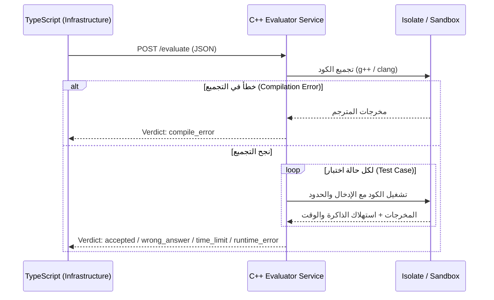

# عقد محرّك التقييم (Evaluator Contract)

> **الإصدار:** 1.0.0  
> **الحالة:** معتمد للمرحلة 0  
> **الهدف:** توثيق واجهة الاتصال (JSON Schema) بين نظام TypeScript (طبقة Infrastructure) وخدمة التقييم المستقلة المكتوبة بلغة C++ (`services/evaluator`).

---

## 1. نظرة عامة والمعمارية

محرّك التقييم هو خدمة مستقلة (Microservice) تعمل داخل حاوية Docker أو بيئة معزولة (`isolate sandbox`) خالية تماماً من الاتصال بالشبكة الخارجية.



---

## 2. نقطة النهاية (Endpoint)

- **البروتوكول:** HTTP/1.1
- **المسار:** `POST /evaluate`
- **الترويسة (Headers):**
  - `Content-Type: application/json; charset=utf-8`
  - `Accept: application/json`

---

## 3. مواصفة الطلب (Evaluation Request)

### 3.1 بنية الـ JSON

```json
{
  "submission_id": "sub-12345-abc",
  "exercise_id": "ex-cpp-001",
  "language": "cpp",
  "language_version": "c++20",
  "student_code": "#include <iostream>\n\nint main() {\n    int a, b;\n    if (std::cin >> a >> b) {\n        std::cout << (a + b) << std::endl;\n    }\n    return 0;\n}",
  "test_cases": [
    {
      "id": "tc-1",
      "input": "5 10\n",
      "expected_output": "15\n",
      "is_hidden": false
    },
    {
      "id": "tc-2",
      "input": "-3 7\n",
      "expected_output": "4\n",
      "is_hidden": true
    }
  ],
  "limits": {
    "max_cpu_time_ms": 2000,
    "max_wall_time_ms": 4000,
    "max_memory_mb": 128,
    "max_output_bytes": 65536,
    "allow_network": false
  }
}
```

### 3.2 تفاصيل الحقول (Request Fields)

| الحقل | النوع | إلزامي؟ | الوصف |
|---|---|---|---|
| `submission_id` | `string` | نعم | معرّف فريد للمحاولة (UUID) لتتبع السجلات |
| `exercise_id` | `string` | نعم | معرّف التمرين التعليمي |
| `language` | `string` | نعم | اللغة المستهدفة للتجميع والتشغيل (`cpp`) |
| `language_version` | `string` | لا | إصدار المترجم الافتراضي (`c++20`) |
| `student_code` | `string` | نعم | الشفرة المصدرية التي كتبها المتعلم |
| `test_cases` | `array` | نعم | قائمة حالات الاختبار المطلوبة للتحقق من الحل |
| `test_cases[].id` | `string` | نعم | معرّف حالة الاختبار |
| `test_cases[].input` | `string` | نعم | المدخلات عبر `stdin` |
| `test_cases[].expected_output` | `string` | نعم | المخرجات المتوقعة عبر `stdout` |
| `test_cases[].is_hidden` | `boolean` | لا | هل حالة الاختبار مخفية عن المتعلّم؟ (الافتراضي `false`) |
| `limits.max_cpu_time_ms` | `number` | نعم | أقصى وقت لمعالج التجميع والتشغيل بالميللي ثانية (مثال: `2000`) |
| `limits.max_wall_time_ms` | `number` | نعم | أقصى وقت حقيقي كلي بالميللي ثانية (مثال: `4000`) |
| `limits.max_memory_mb` | `number` | نعم | سقف استهلاك الذاكرة بالميجابايت (مثال: `128`) |
| `limits.max_output_bytes` | `number` | لا | أقصى حجم مخرجات مسموح به لمنع الامتلاء (افتراضي `65536`) |
| `limits.allow_network` | `boolean` | نعم | **يجب أن يكون `false` دائماً** — عزل شبكي تام |

---

## 4. مواصفة الاستجابة (Evaluation Response)

### 4.1 بنية الـ JSON

```json
{
  "submission_id": "sub-12345-abc",
  "verdict": "accepted",
  "compilation": {
    "success": true,
    "compiler_output": "",
    "compilation_time_ms": 140
  },
  "summary": {
    "total_tests": 2,
    "passed_tests": 2,
    "peak_memory_kb": 2048,
    "total_cpu_time_ms": 14
  },
  "test_results": [
    {
      "test_case_id": "tc-1",
      "verdict": "passed",
      "actual_output": "15\n",
      "cpu_time_ms": 7,
      "memory_kb": 2048,
      "diff": null
    },
    {
      "test_case_id": "tc-2",
      "verdict": "passed",
      "actual_output": "4\n",
      "cpu_time_ms": 7,
      "memory_kb": 2048,
      "diff": null
    }
  ],
  "diagnostics": {
    "detected_error_category": null,
    "hint_arabic": null
  }
}
```

### 4.2 أنواع الأحكام النهائية (Verdict Types)

| الحكم (`verdict`) | المعنى بالعربية |
|---|---|
| `accepted` | الحل صحيح واجتاز جميع الاختبارات بنجاح |
| `wrong_answer` | الكود يعمل ولكنه أعطى مخرجات غير متطابقة مع المتوقع |
| `compile_error` | فشل في تجميع الكود (Syntax Error / Compiler Error) |
| `time_limit_exceeded` | تجاوز الكود الحد الأقصى للوقت المسموح (حلقة لا نهائية مثلاً) |
| `memory_limit_exceeded` | تجاوز الكود سقف الذاكرة المخصص |
| `runtime_error` | توقف البرنامج بخطأ أثناء التشغيل (Crash / Segfault / Division by zero) |
| `internal_error` | خطأ في خادم التقييم المعزول نفسه |

### 4.3 تصنيف الأخطاء (Error Categories & Diagnostics)

تُستخرج هذه الحقول لمساعدة الوكيل الذكي على فهم نوع خطأ المتعلم:

```json
"diagnostics": {
  "detected_error_category": "off_by_one",
  "hint_arabic": "تأكد من شرط توقف الحلقة التكرارية، هل يبدأ العداد من 0 أو 1؟"
}
```

الفئات المعتمدة مبدئياً:
- `syntax_error` (أخطاء صياغة الأقواس والفواصل المنقوطة)
- `off_by_one` (خطأ في حدود التكرار أو حجم المصفوفة)
- `infinite_loop` (حلقة غير منتهية)
- `uninitialized_variable` (استخدام متغير دون إعطائه قيمة مبدئية)
- `division_by_zero` (قسمة على صفر)
- `out_of_bounds` (الوصول لموقع خارج حدود المصفوفة)

---

## 5. قواعد الأمان الإلزامية لمحرّك C++

1. **لا شبكة مطلقاً:** يجب تشغيل الساندبوكس بدون أي واجهة شبكة (`--share-net=false` أو `unshare(CLONE_NEWNET)`).
2. **صلاحيات غير جذرية (Unprivileged User):** يُشغل كود الطالب بمستخدم محدود الصلاحيات (`nobody` أو مستخدم مخصص بدون `sudo`).
3. **نظام ملفات للقراءة فقط (Read-only Root):** لا يُسمح بأي كتابة إلا في مجلد مؤقت محدد الحجم والوقت (`tmpfs`).
4. **تحديد سقف العمليات (Process Limit):** أقصى عدد عمليات فرعية مسموح به هو 1 (لمنع هجمات Fork Bombs).
